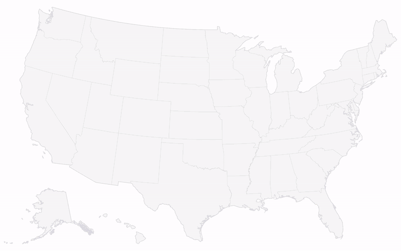
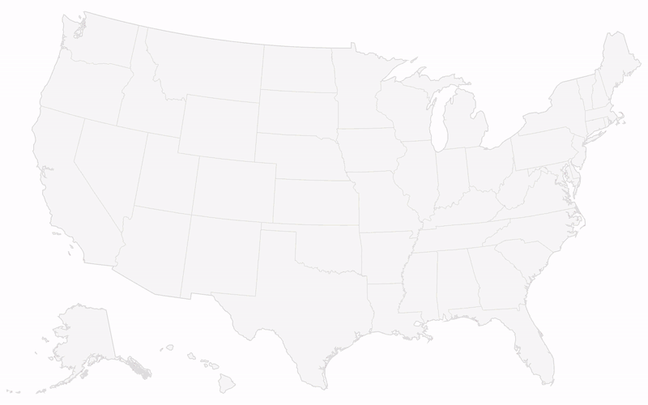
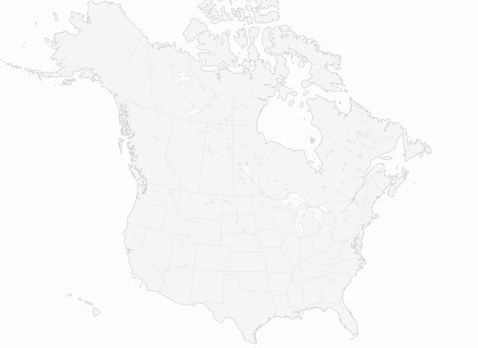
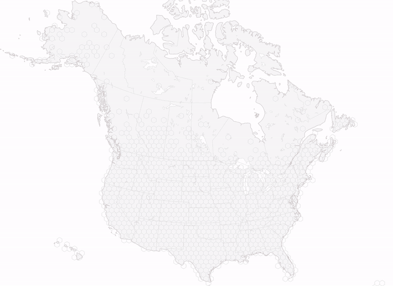

Pop vs Soda
=========

The Pop vs Soda Page is a linguistic survey created by [Alan McConchie](https://github.com/almccon) and hosted at http://popvssoda.com.

## Layout

- `index.html`, `js/map.js`, `css/style.css`: the interactive county map.
- `vendor/`: vendored copies of [D3](https://d3js.org) v7.9.0 and [topojson-client](https://github.com/topojson/topojson-client) v3.1.0.
- `d3/us.json`: US county, state and land boundaries (TopoJSON).
- `d3/pvscounty_fips.tsv`: survey responses aggregated by county (joined on the `id` column, the county FIPS code).
- `experiments/`: work-in-progress alternative views of the survey data (isoglosses, ZIP Voronoi, hex bubbles, county bubbles, state donuts). See `experiments/index.html`.
- `archive/`: earlier versions of the page.

## Running locally

The page loads its data with `fetch`, so it needs to be served over HTTP rather than opened as a file:

    python3 -m http.server

Then open http://localhost:8000.

## Animations

Recordings of the bubble experiments as they grow in from the south and settle. Each GIF links to a full-size MP4 (1920 px wide, 15 seconds).

**County bubbles, sized by responses** ([MP4](experiments/animations/county-bubbles-responses.mp4))

**County bubbles, sized by 2010 county population** ([MP4](experiments/animations/county-bubbles-population.mp4))

**Hex bubbles, 66-mile hexagons** ([MP4](experiments/animations/hex-bubbles.mp4))

**Hex bubbles, with the hexagons outlined** ([MP4](experiments/animations/hex-bubbles-outlined.mp4))

