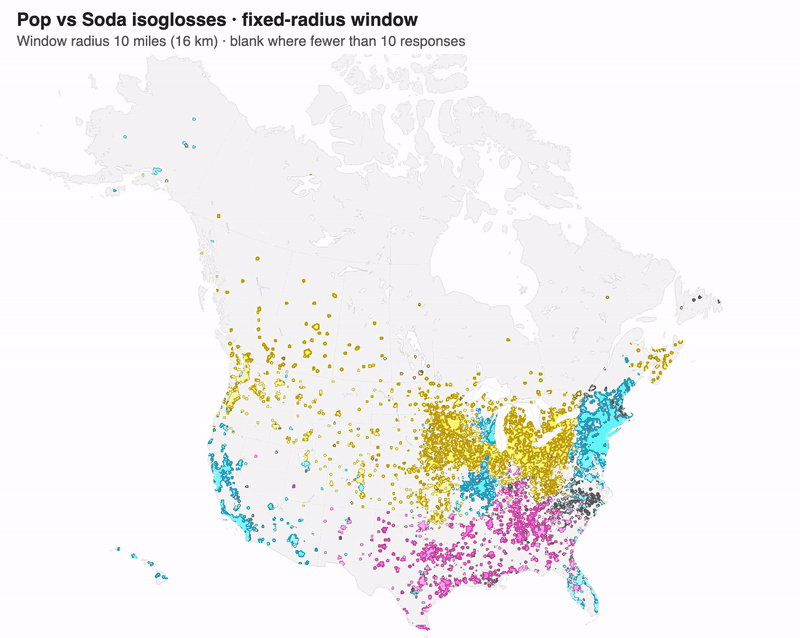
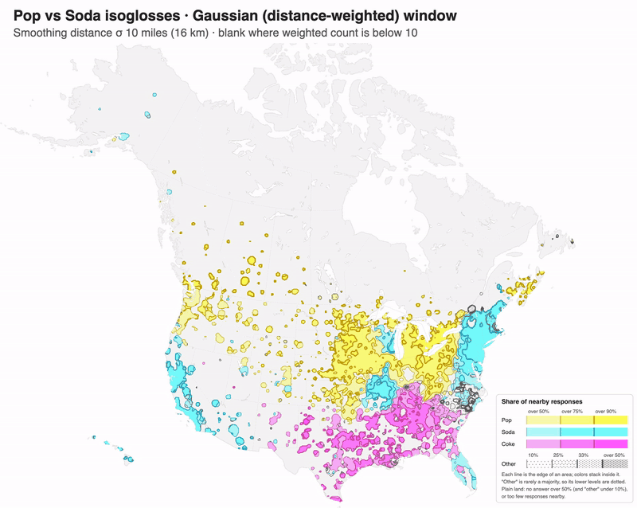
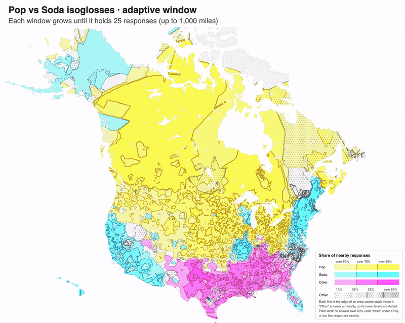
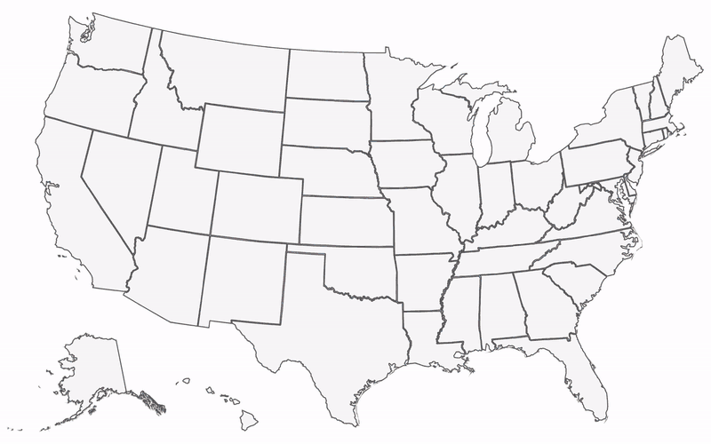
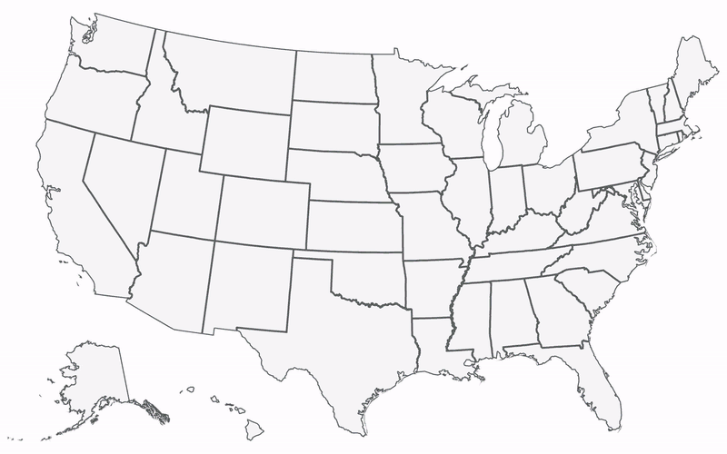
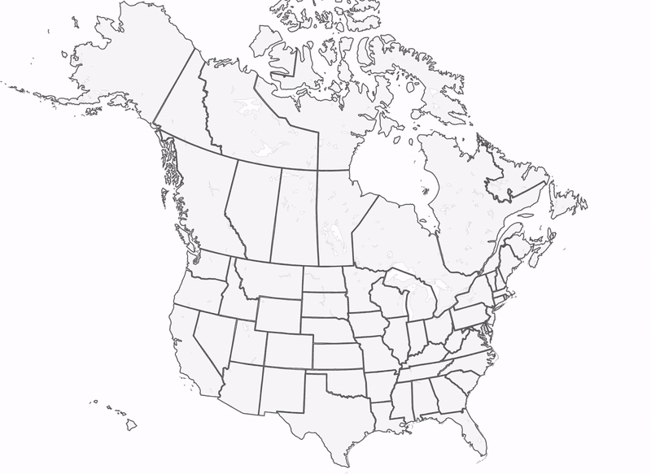

Pop vs Soda
=========

The Pop vs Soda Page is a linguistic survey created by [Alan McConchie](https://github.com/almccon) and hosted at http://popvssoda.com.

## Layout

- `index.html`, `js/map.js`, `css/style.css`: the interactive county map.
- `vendor/`: vendored copies of [D3](https://d3js.org) v7.9.0 and [topojson-client](https://github.com/topojson/topojson-client) v3.1.0.
- `d3/us.json`: US county, state and land boundaries (TopoJSON).
- `data/`: survey responses aggregated by ZIP code, county, census division and state. See `data/README.md`.
- `experiments/`: work-in-progress alternative views of the survey data (US counties with Canadian census divisions, isoglosses, ZIP Voronoi, ZIP circles, hex bubbles, county bubbles, state and province donuts). See `experiments/index.html`.
- `statistics/`, `countystats/`: static statistics pages (by state and province, and by county), at the same addresses as the old site's. Built by `scripts/build_statistics.py`.
- `archive/`: earlier versions of the page.

## Running locally

The page loads its data with `fetch`, so it needs to be served over HTTP rather than opened as a file:

    python3 -m http.server

Then open http://localhost:8000.

## Animations

Recordings of the experiments. Each GIF links to a full-size MP4 (1920 px wide).

### Isoglosses

The isogloss map as its window settings step through their range, four steps per second.

**Fixed-radius window, 10 to 300 miles** (blank where fewer than 10 responses; [MP4](experiments/animations/isoglosses-fixed.mp4))

**Gaussian window, σ from 10 to 400 miles** (blank where the weighted count is below 10; [MP4](experiments/animations/isoglosses-gaussian.mp4))

**Adaptive window, 25 to 3,000 responses** (largest window 1,000 miles; [MP4](experiments/animations/isoglosses-adaptive.mp4))

### Bubbles

The bubble experiments as they grow in from the south and settle (15 seconds each).

**County bubbles, sized by responses** ([MP4](experiments/animations/county-bubbles-responses.mp4))

**County bubbles, sized by 2010 county population** ([MP4](experiments/animations/county-bubbles-population.mp4))

**Hex bubbles, 66-mile hexagons** ([MP4](experiments/animations/hex-bubbles.mp4))

**Hex bubbles, with the hexagons outlined** ([MP4](experiments/animations/hex-bubbles-outlined.mp4))

### Swelling state outlines

The same bubbles with each state (and province) outlined. Each outline starts as the state's border and swells and shifts with its own bubbles, so you can still see which state each bubble came from.

**County bubbles with state outlines** ([MP4](experiments/animations/county-bubbles-outlines.mp4))

**County bubbles, one per county in the CMY mix, with state outlines** ([MP4](experiments/animations/county-bubbles-blended-outlines.mp4))

**Hex bubbles with state and province outlines** ([MP4](experiments/animations/hex-bubbles-state-outlines.mp4))

